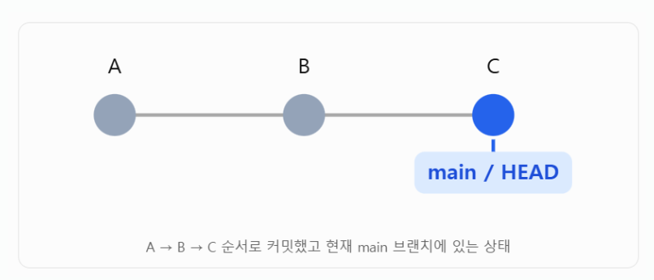
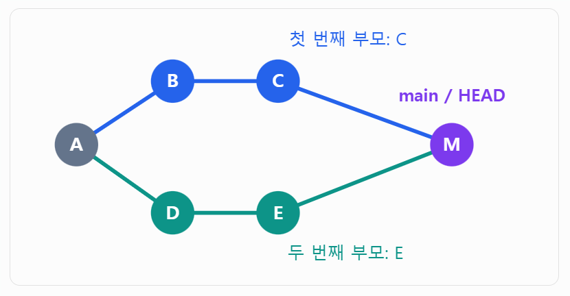

## 01 head
github에서 head는 내가 작업하고 있는 위치를 가리키는 포인터

*사용 이유
여러 작업을 진행 시 checkout으로 다른 branch로 이동하게 됨



- main : main 브랜치의 최신 커밋 C를 가리킴
- HEAD : 현재 선택한 브랜치인 main을 가리킴
- HEAD~1 : 현재 커밋의 첫번째 부모
- HEAD^ : 현재 커밋의 바로 이전 커밋
*이전 상태 복원 시 HEAD^ 으로 이전 부모 커밋을 접근

*merge 커밋은 두 브랜치를 합치기 때문에 부모가 2개일 수 있음


### detached head
head가 브랜치가 아닌 특정 커밋을 직접 가리키는 상태

head가 브랜치에서 분리된 상태

head가 main을 거치지 않고 b라는 커밋을 직접 가리키는 것

```
A → B → C
    ↑   ↑
   HEAD main
```

```
    D (HEAD)
   /
A → B → C (main)

```
- main 브랜치 : c 커밋을 가리킴
- head : d 커밋을 가리키나 브랜치가 없음

d가 즉시 삭제되는 것은 아니지만 나중에 git의 정리 작업으로 인해 유실될 수 있는 위험이 있음

따라서 main 브랜치로부터 새로운 작업 브랜치로 checkout 후 commit을 생성해야함

### commit과 branch의 차이
- commit : 저장된 기록
- branch : 기록의 이름


## 02 merge 와 rebase 

### 3 way merge 
1) 2 브랜치에 대한 공통 조상 찾기 
2) 공통 조상 파일 / 각 브랜치 파일 상태 비교

### fast forward merge
새 merge 커밋을 생성하지 않고 브랜치가 가리키는 위치만 앞으로 이동해 병합

내가 작업하던 브랜치에는 새로운 커밋이 없고, 다른 사람이 작업한 브랜치에만 새로운 커밋이 있는 상황

### rebase 
다른 브랜치를 기준으로 내 커밋들을 다시 쌓기

커밋 기록을 일직선으로 정리해 작업 흐름을 이해하기 쉽다

```
refactor: 로그인 로직 분리
feat: 로그인 API 구현
fix: 로그인 오류 수정
feat: JWT 검증 추가
refactor: 로그인 로직 분리
```

*merge 시의 커밋 예시
```
feat: 로그인 API 구현
merge main into feature/login
fix: 로그인 오류 수정
merge main into feature/login
feat: JWT 검증 추가
merge main into feature/login
refactor: 로그인 로직 분리
```


```
main:     A ─ B ─ C ─ D
               \
feature:        E ─ F
```

- 최신 main의 D 위에 E를 다시 적용하다가 충돌이 발생 가능
- 충돌을 해결하고 나면 F를 적용

*merge를 활용하는 경우 C, D, E, F의 변경을 함께 다루게 됨 

*Squash: 여러 커밋을 하나로 합치는 것

## 03 reset, revert

- reset : branch를 이전 커밋으로 복원
기록 x
브랜치 포인터를 이동시켜 그 결과 기존 커밋이 브랜치 이력에서 보이지 않게함 


- revert : 기존 커밋을 취소하는 커밋을 남기고 새로운 커밋을 생성

main으로 공유된 작업에 대한 수정을 하는 것이므로 취소이더라도 기록을 남기는 것이 일반적으로 더 권장됨


### 직접 수정하지 않는 이유
- 개발자가 10곳을 찾아서 직접 원래대로 수정해야 함

*git revert D
- Git이 D 커밋에서 변경한 내용을 기준으로 역방향 패치를 생성함


```
            C (feature-A, 너)
           /
A → B (main)
           \
            E → F (feature-B, 팀원)
         
         
```